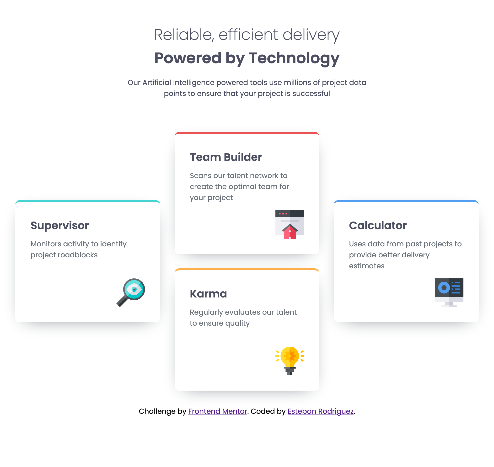
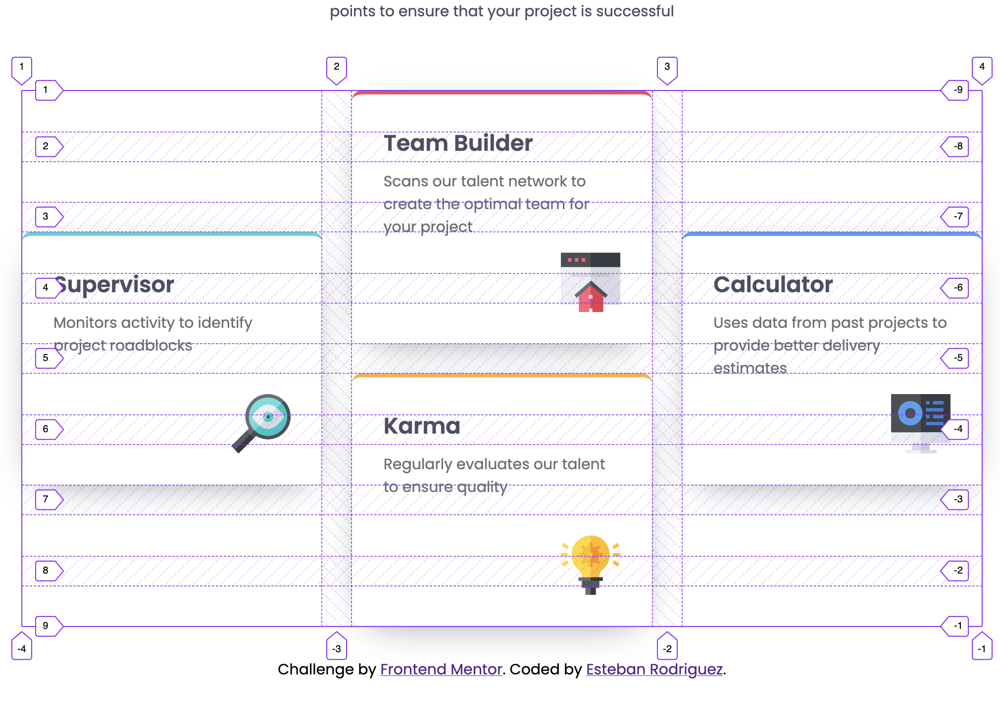
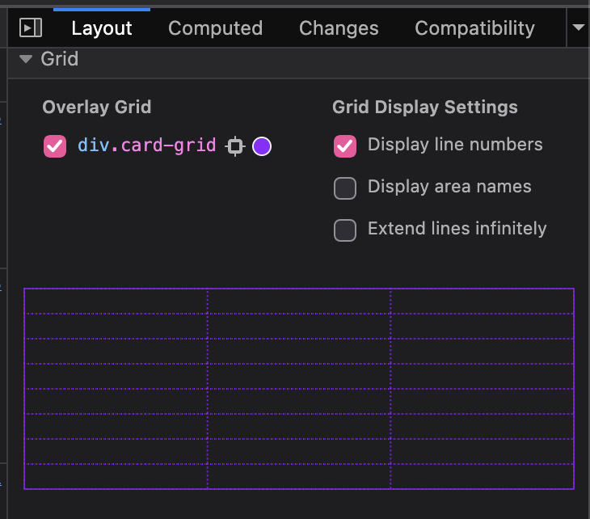
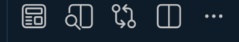
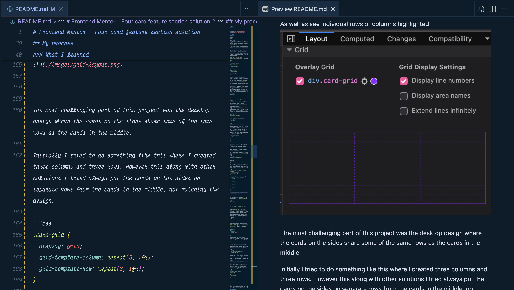

# Frontend Mentor - Four card feature section solution

This is a solution to the [Four card feature section challenge on Frontend Mentor](https://www.frontendmentor.io/challenges/four-card-feature-section-weK1eFYK). Frontend Mentor challenges help you improve your coding skills by building realistic projects.

## Table of contents

- [Overview](#overview)
  - [Screenshot](#screenshot)
  - [Links](#links)
- [My process](#my-process)
  - [Built with](#built-with)
  - [What I learned](#what-i-learned)
  - [Continued development](#continued-development)
  - [Useful resources](#useful-resources)
  - [AI Collaboration](#ai-collaboration)
- [Author](#author)
- [Acknowledgments](#acknowledgments)

## Overview

### Screenshot



### Links

- [Live Site](https://estebanrodriguez28.github.io/four-card-feature-section/)
- [GitHub](https://github.com/estebanrodriguez28/four-card-feature-section)

## My process

### Built with

- Semantic HTML5 markup
- Flexbox
- CSS Grid
- SCSS
- Mobile-first workflow

### What I learned

I started by estimating how long the project would take and giving myself a deadline. I calculated the project would take 9 hours spread over 3 days with a deadline of November 25th. I kept this deadline in a project management tool (Notion). The project overall took me around 10 hours, and I finished a day later November 26th.

One reason why I was a day late is because two days I worked an hour less than I estimated I would need to work each day to finish on time (3 hours). Next was that I had never used grid in css before which required some time to understand and learn. Overall, this project was a lot quicker than the last one and my estimates were pretty accurate.

> [!IMPORTANT]  
> Estimate how long the project will take you plus give a deadline. If you miss the deadline reflect why and see if your estimates were accurate.

Using BEM naming made the css very organized where each card shared the same classes for the content (title, text, icon) so changing the css for one card will update all other cards as well. Also adding modifiers to split up the cards makes the css very readeable.

```html
<article class="card card--supervisor">
  <h2 class="card__title">Supervisor</h2>
  <p class="card__text">Monitors activity to identify project roadblocks</p>
  
</article>
```

```scss
// scss/components/_card.scss
.card {
  border-top: 4px solid;

  &--karma {
    border-color: $orange;
  }

  &--supervisor {
    border-color: $cyan;
  }

  &--team-builder {
    border-color: $red;
  }

  &--calculator {
    border-color: $blue;
  }
}
```

> [!NOTE]  
> Using BEM for naming makes css more maintainable.

This was my first time using grid in css. Grid allows you to create complex layouts with both rows and columns while flexbox is one dimensional (either a column or row). To use grid, there must be a grid parent set to `display: grid`.

You can use the `fr` unit or fraction unit in css grid to define how the remaining space within the container will be distributed among the grid items. The columns or rows are first calculated based on the size of their content, the fr unit can be used to distribute extra space if there is any.

You define the number of columns or rows you want in your grid with `grid-template-columns` or `grid-template-rows`. By default there will be 1 column and the grid will create rows as needed to fit the content. In the example below we create a two column grid that will take up the same fraction of remaining space.

The first and second column take up 1 fraction, the sum of the fractions combined becomes the denominator. So each column takes up 1/2 or 50% of the extra space. If the columns were 1fr 2fr, then the second column would take up 2/3 of the space and the first column would take up 1/3.

```scss
.grid-parent {
  display: grid;
  grid-template-columns: 1fr 1fr;
}
```

---

\
**You can place grid items within specific columns or rows of the grid and grid items can span accross multiple rows and columns.**

In the example, I put one of the cards (a grid item) to be in column 2 and to go from row line 5 to row line 9. However those numbers dont represent the rows themeselves (or row index), those numbers represent the row lines.

Imagine a 2 column grid with one 1 row. How would you make an item in that grid span both columns? Well you would set the `grid-column` of that item to 1/2 right? Start at the first column end at the second column.

But that wouldn't work because the start and end column or rows you set on grid items are based on the column or row lines. In the scenario with 2 column grid, to make an item span both columns you would set the grid item's `grid-column` to 1/3. Why? Because the column lines goes from 1 to 2 (first column), then 2 to 3 (second column). If you set the grid column to 1/2, the item would only take up the first column not both columns.

```scss
// scss/layout/_grid.scss
.grid-parent {
  display: grid;
  column-template: repeat(1fr, 3);
  row-template: repeat(1fr, 5);
}

.card {
  // lay out the cards in the grid on desktop
  &--karma {
    grid-column: 2;
    grid-row: 5/9;
  }
}
```

> [!TIP]
> Use the repeat function in css instead of having to write out multiple fr units to create columns or rows.

---

Back to BEM, I was unsure of how to use BEM for the text at the top of the page. For the card it's easy, the card is the block everything inside it is an element (or modifier). But what about for the text? What would the block be exactly?

Well I ended up making the block a header. I guess this works, I am still getting used to BEM, I am curious for larger projects how BEM would be used and what to name something if you are not sure what the block would be.

Generally, I think about a block as an individual UI component. It's a bit confusing when comes to something like a group of text by itself, not really something I would think of as a UI component but I still used BEM.

```scss
// scss/components/_header.scss
.header {
  text-align: center;

  &__title {
  }

  &__description {
  }
}
```

---

Devtools has an incredibly useful tool for visualizing the grid where you can see the rows and columns of the grid.


As well as see individual rows or columns highlighted


---

The most challenging part of this project was the desktop design where the cards on the sides share some of the same rows as the cards in the middle.

Initially I tried to do something like this where I created three columns and three rows. However this along with other solutions I tried always put the cards on the sides on separate rows from the cards in the middle, not matching the design.

```css
.card-grid {
  display: grid;
  grid-template-column: repeat(3, 1fr);
  grid-template-row: repeat(3, 1fr);
}

.card {
  &--calculator {
    grid-column: 3;
    grid-row: 2;
  }
}
```

After reading through documentation (linked in the resources section) without being closer to a solution, I finally decided to look up some example of how to use grid. One example, from freefrontend, gave me the idea of splitting the grid container into several more rows. With more rows I could make the cards to the side overlap some of the rows from the cards in the middle while still being in their own column.

```scss
// scss/layout/grid.scss
@media screen and (min-width: $desktop-breakpoint) {
  .card-grid {
    grid-template-columns: repeat(3, 1fr);
    // several rows in the grid
    grid-template-rows: repeat(8, 1fr);
    width: min(70rem, 100%);
  }
}

@media screen and (min-width: $desktop-breakpoint) {
  .card {
    // lay out the cards in the grid on desktop
    &--karma {
      grid-column: 2;
      grid-row: 5/9;
    }

    &--supervisor {
      grid-column: 1;
      grid-row: 3 / 7;
    }

    &--team-builder {
      grid-column: 2;
      grid-row: 1 / 5;
    }

    &--calculator {
      grid-column: 3;
      grid-row: 3/7;
    }
  }
}
```

> [!IMPORTANT]
> If reading through articles or documentation is not getting you closer to a solution, look up examples of what you are trying to implement (like css grid).

---

For the header, to make the description a certain size to break its lines according to the design, I used `inline-size` which sets the width for the text container. But on small screens the width of the text would overflow the screen horizontally. The fix was to use `max-inline-size` to make sure the text could fit on smaller screens.

```css
.header {
  &__description {
    max-inline-size: 300px;
  }
}
```

> [!IMPORTANT]  
> Use units that allows content to scale to multiple screen sizes like `max-width` or `min-height`. Test your site on several viewports.

---

I understood `box-shadow` more, the first parameter is the horizontal offset, in the design the shadow looks centered on the card so its 0. The second parameter is the vertical offset, I add a vertical offset to make sure the card shadow does not appear at the top of the card like in the design. The third parameter is the blur, the shadow looks fairly blurred in the design so set that to a high value.

The fourth parameter is the spread, how large to make the shadow. In the design, the shadow looks very blurred but a high blur value makes the shadow larger as well so setting spread to negative reduces the size of the shadow while still giving the shadow a lot of blur. Optionally you can add color to the shadow.

```scss
.card {
  box-shadow: 0px 10px 40px -20px $grey-400;
}
```

---

Initially for the card's icon I used absolute positioning (`position: absolute`) and the bottom and right properties (`bottom:0; right:0`) with card set to `position: relative`. I used Claude to review my project and pointed out a better way was to set the card to be a flex container then use `margin-top: auto` to move the icon to the bottom then set `align-self: flex-end` to move it to the very right.

```scss
.card {
  display: flex;
  flex-direction: column;
  &__icon {
    width: 60px;
    margin-top: auto;
    align-self: flex-end;
  }
}
```

---

Before I had a height on the grid container with vh units but instead in the review Claude gave, you can give the card a `min-height` in rem so the card's height can stay consistent with the design accross screens and can still grow if needed. The height of the grid items can be controlled by the grid items themselves.

```css
.card {
  min-height: 16rem;
}
```

However the width of items is controlled by the grid container, we can set a `max-width` to the grid container. Before I set the width of the grid container to view width. Problem with that is on very wide screen, the grid container is tied to the view width so the columns and the cards are extremely wide. Instead we can give a max width in rem for the grid container to match the design.

```scss
@media screen and (min-width: $desktop-breakpoint) {
  .card-grid {
    grid-template-columns: repeat(3, 1fr);
    grid-template-rows: repeat(8, 1fr);
    width: min(70rem, 100%);
  }
}
```

You could also set an explicity width to the columns instead of using fraction units like `grid-template-columns: 10rem 10rem 10rem`.

Better to use view width or view height units `vh or vw` when you need to tie the size of an element to the viewport like a hero section.

> [!NOTE]  
> When using grid, use the parent grid for laying out the grid items and controlling the width, grid items themselves can control height.

---

Before I had classes for the font families with a separate class for each font weight then added those classes to the html. But each of those classes shared the same `font-family` and `font-style` the only thing that was different was the `font-weight` which could be added directly to the elements instead of having an other class. Then the `font-family` could be added to the body.

```scss
// scss/base/_typography.scss
body {
  font-family: "Poppins", sans-serif;
  font-style: normal;
  font-size: 15px;
}

.card {
  &__title {
    color: $grey-500;
    margin-bottom: 10px;
    font-weight: 600;
  }
}
```

---

VSCode has a useful feature to preview what your markdown for the README looks like so you just need to make one commit for you README.

Step one, open your README file then you should see these icons on the top right of VSCode:

\
\
The first icon allows you to open the preview of the README, the second icon opens the preview side by side with your README in Markdown:


---

I was curious what other ways I could create the desktop design with css grid. The way I did works but I used more rows than I needed to. There were two other ways to create the desktop design that Claude gave.

One was to use grid areas, on the grid container we can define a grid area with `grid-template-areas` using words. Each line or quotes is a row and each word within that row is a column. A dot represents an empty cell. The spacing in the row does not create new columns so we can add spaces to make the `grid-template-areas` look like the layout in the design. Note you still need to specify `grid-template-columns` and use fr units to make sure the grid items take up equal space.

Then on the grid item's you assign them the `grid-area` that the item corresponds to from the `grid-template-areas` in the grid container. Grid items can span multiple rows by writing the same word on more than one line in `grid-template-areas` or multiple times in the same line to span columns.

The pro of this method is that it's readable, looking at the `grid-template-areas` on the grid container shows the layout clearly with words instead of row lines or columns. Grid areas are useful when you know how many rows and columns you need, row lines or columns can be more useful when you don't or need a lot.

```scss
@media screen and (min-width: $desktop-breakpoint) {
  .card-grid {
    grid-template-columns: repeat(3, 1fr);
    grid-template-areas:
      ".          team-builder  ."
      "supervisor team-builder  calculator"
      "supervisor    karma      calculator"
      ".             karma      .";
    width: min(70rem, 100%);
  }
}

@media screen and (min-width: $desktop-breakpoint) {
  .card {
    // lay out the cards in the grid on desktop
    &--karma {
      grid-area: karma;
    }

    &--supervisor {
      grid-area: supervisor;
    }

    &--team-builder {
      grid-area: team-builder;
    }

    &--calculator {
      grid-area: calculator;
    }
  }
}
```

The second solution was to use two rows, have the cards on the sides span both rows with the cards in the middle on separate rows. By default grid items will stretch to fill the columns and rows they are placed in. However we can align grid items in different ways. For the one's on the side we dont want them to span both rows, instead we want to center them in between the two rows which can be done with `align-self: center`. When you set `align-self` to a grid item other than stretch, the default stretch gets overidden and the grid item's height (or width with `justify-items`) will shrink to fit the content.

```scss
@media screen and (min-width: $desktop-breakpoint) {
  .card-grid {
    grid-template-columns: repeat(3, 1fr);
    grid-template-rows: repeat(2, 1fr);
    width: min(70rem, 100%);
  }
}

@media screen and (min-width: $desktop-breakpoint) {
  .card {
    // lay out the cards in the grid on desktop
    &--karma {
      grid-column: 2;
      grid-row: 2;
    }

    &--supervisor {
      grid-column: 1;
      grid-row: 1/3;
      // centers this grid item vertically in the rows
      align-self: center;
    }

    &--team-builder {
      grid-column: 2;
      grid-row: 1;
    }

    &--calculator {
      grid-column: 3;
      grid-row: 1/3;
      align-self: center;
    }
  }
}
```

I put this method with the two rows on a separate branch and the grid area solution on the main branch.

### Continued development

Overall I learned a lot about css grid and I look forward to using grid in more complex layouts in the upcoming projects.

### Useful resources

- [Interactive CSS Grid Guide](https://www.joshwcomeau.com/css/interactive-guide-to-grid/#mental-model-1) - This article explains css grid in a visual and clear way, highly recommend.
- [CSS Grid Example](https://codepen.io/cameronknight/pen/yLeoGoO) - The css grid example that helped me come up with my solution.

### AI Collaboration

I used Claude to review my project once I thought I was finished. Gave a lot of suggestions to improve my use of css grid that helped me understand better such as using a max-width on the grid container and a min-height on the grid items. As well as other ways to make the site more responsive like capping the width of the header description.

## Author

- Frontend Mentor - [@estebanrodriguez28](https://www.frontendmentor.io/profile/estebanrodriguez28)

## Acknowledgments

Thank you to the front end mentor team for putting this challenge together and for linking great resources to learn (interactive css guide) and the authors of the resources I used.
